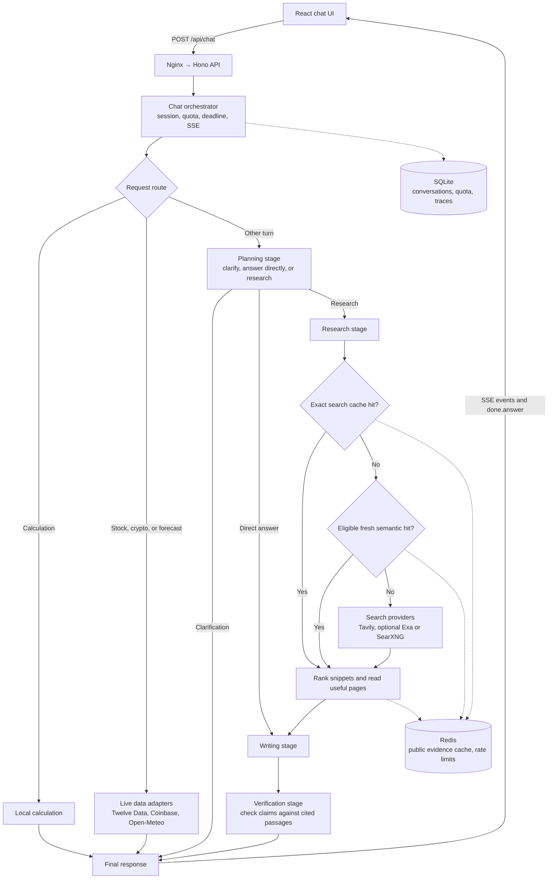

# Glint

Glint is a research chat app that answers from supplied inputs, looks up live data, or searches the web and verifies cited claims. A single TypeScript pipeline coordinates four specialized stages for planning, research, writing, and verification.

## Architecture

| Component              | Responsibility                                                                                                                                        |
| ---------------------- | ----------------------------------------------------------------------------------------------------------------------------------------------------- |
| React and Vite web app | Composer, chat history, source citations, claim checks, and request traces                                                                            |
| Nginx and Hono API     | Serve the web build, validate chat requests using shared Zod contracts, and stream typed events                                                       |
| Chat orchestrator      | Route the turn, share a deadline and quota budget across stages, and cancel work on disconnect                                                        |
| Research providers     | Groq and Gemini for hosted models, Tavily with optional Exa and SearXNG for search, and local MiniLM for embeddings                                   |
| Live data adapters     | Twelve Data for equities, Coinbase Exchange for crypto, and Open-Meteo for forecasts                                                                  |
| Storage                | Redis for shareable public evidence and rate limiting, with bounded in-memory fallbacks. SQLite stores conversations, quota reservations, and traces. |



## Request flow

1. **Accept the turn.** The browser sends `POST /api/chat`. The API validates it, finds or creates the session’s conversation, and starts a Server-Sent Events stream. The browser enables web search by default and sends Auto so the planner decides when it is useful.
2. **Select a route.** Supported calculations can run locally from the prompt. Recognized quote and forecast requests with web access use the dedicated data adapters. Other public turns can get a direct hosted answer, a clarification question, or a research plan. A public turn with search disabled and hosted answering explicitly allowed can go straight to the model.
3. **Find or reuse evidence.** The research stage checks the exact search cache first. On a miss, eligible public searches can reuse fresh results from a close paraphrase. Otherwise it calls a configured search provider. It ranks snippets, fetches pages when useful, and reuses cached page text, chunks, and embeddings.
4. **Draft and check claims.** The writer gives each factual claim its own citations. The verifier checks the cited passages and can use an alternate excerpt from the evidence already retrieved. When time allows, the pipeline retries missing parts without discarding verified claims. If verification cannot finish, relevant evidence can still be returned as labeled source excerpts.
5. **Finalize the turn.** The API sends the final status and Markdown in `done.answer` and saves completed turns and their evidence to SQLite. The browser can show the citations, claim verdicts, and trace for that request.

The semantic cache reuses **search results**. A hit skips that provider dispatch and its search credit. The current turn still goes through retrieval, drafting, and verification. For example, “When was Portal 2 released?” and “When did Portal 2 come out?” can share fresh search results when their search constraints match.

## Run the stack

Use Docker with the Compose plugin. Copy `.env.example` to `.env` if you want to change the published ports.

```sh
docker compose up --build --wait
curl --fail http://localhost:3000/health
curl --fail http://localhost:8080/health
docker compose exec -T redis redis-cli ping
docker compose down
```

Both health URLs return `{"status":"ok"}` and Redis returns `PONG`. The web shell is available at http://localhost:8080. The API health endpoint checks liveness. Compose checks Redis independently.

## Local development

Use Node.js 20.19 or later and the pnpm version pinned in `package.json`. Set `HOST`, `PORT`, or `REDIS_URL` in the process environment to override API defaults.

```sh
pnpm install --frozen-lockfile
pnpm format:check
pnpm lint
pnpm typecheck
pnpm test
pnpm build
pnpm --filter @chatagent/api start
```

Run `pnpm --filter @chatagent/web dev` in another terminal to serve the web shell.

## Dependencies

- Hono and its Node adapter serve the HTTP API.
- Zod validates runtime settings and shared message contracts.
- React and React DOM provide the browser entry point. Vite serves and builds it.
- TypeScript and the Node and React type packages enforce compile-time contracts.
- ESLint, its JavaScript and TypeScript rules, and Prettier check code and formatting.
- Vitest runs the acceptance tests.

## Live LLM smoke test

Copy `.env.example` to `.env`. Set the API key for Groq or Gemini. The template includes small and strong model IDs for both providers. Use Groq first and Gemini as the fallback when both are configured. Pick chat models with access on a free-tier project and keep billing disabled. Check the [Groq model catalog and limits](https://console.groq.com/docs/models), [Groq Free Plan limits](https://console.groq.com/docs/rate-limits), [Gemini models](https://ai.google.dev/gemini-api/docs/models), and [Gemini free-tier availability](https://ai.google.dev/gemini-api/docs/pricing). Use public or synthetic prompts with hosted models.

```sh
pnpm build
node --env-file=.env apps/api/dist/llm/smoke.js
```

The smoke test checks the configured model IDs against each enabled provider catalog and sends one synthetic structured request through the provider chain. An exit code of zero and an `llm/smoke_passed` trace indicate success. `pnpm test` covers the offline provider behavior and uses fake responses.

## Search providers and replay

Set `TAVILY_API_KEY` and `TAVILY_MONTHLY_CREDITS` in `.env` for Tavily Basic search. Optionally set `EXA_API_KEY`, `EXA_MONTHLY_MICRODOLLARS`, and `EXA_SEARCH_RESERVE_MICRODOLLARS` for Exa Lite fallback. Use the values in `.env.example` as a starting point and check the [Tavily plan](https://www.tavily.com/pricing) and [Exa plan](https://exa.ai/pricing) before setting limits. Optionally set `SEARXNG_URL` to a self-hosted instance that serves JSON.

The SQLite quota ledger reserves units before dispatch. Each Tavily attempt reserves one credit. Exa reserves the configured estimate per attempt, including highlights. Failed attempts retain their reservation because the upstream may have processed them. Monthly search and daily LLM windows use UTC. Set `GROQ_DAILY_REQUESTS` and `GEMINI_DAILY_REQUESTS` to enforce local daily caps. The ledger exposes usage, limits, and the 80% threshold for the future governor. Provider-side usage can also include requests from other apps using the same account.

```powershell
pnpm build
node --env-file=.env apps/api/dist/search/smoke.js
```

Set `SEARCH_MODE=record` to save successful raw responses under `evals/fixtures/search/recorded`. Run the same command with `SEARCH_MODE=replay` to use those files without network access or quota charges. Replay requires a matching request, including its filters. Use public queries when recording. Provider contract tests use synthetic fixtures shaped like their API responses. Offline tests also exercise record and replay with a mocked HTTP response.

The search adapters enforce domain and publication-date filters on returned results. Date-filtered searches omit undated results. Quoted exact phrases are query hints whose behavior varies by engine.

- better-sqlite3 and its TypeScript definitions provide atomic, persistent quota reservations.

## Safe page fetch

```powershell
pnpm build
node --env-file=.env apps/api/dist/fetch/smoke.js
```

The command fetches a public example page and reports the extracted character count. Pass a public URL as its final argument to check another page. Fetching allows HTTP and HTTPS on standard web ports, resolves and pins public IP addresses on every hop, and limits the download to 3 seconds, four redirects, and 2 MB. HTML, PDF, and plain text are supported. Extraction has a separate 8-second deadline to accommodate cold worker startup. PDFs are limited to 40 pages. The fetcher coalesces concurrent requests, sends conditional validators when available, and caches forbidden, paywalled, and timed-out URLs for ten minutes.

The optional JavaScript fallback starts only when static extraction finds no text. Set `FETCH_BROWSER_ENABLED=true` in the shell and run `docker compose --profile browser up --build --wait`. The Playwright renderer runs in a network-disabled container with a 512 MiB memory cap and a three-second rendering deadline. The API sends the previously downloaded HTML over a shared Unix socket. Pages that require external scripts or API requests can remain unreadable. To return to default operation, stop the renderer and start the API with the flag set to false.

- Undici supports address pinning with an explicit dispatcher, and ipaddr.js classifies IP ranges.
- Readability and jsdom extract article text without running page scripts. PDF.js extracts PDF text, and Playwright provides optional inline rendering.

## Evidence cache

The cache stores only public search results, extracted pages, chunks, embeddings, and eligible fetch failures. A caller must explicitly supply an evidence cache to the live search or page-fetch factory when its input is suitable for sharing across users. Search record and replay continue to use their fixtures directly.

Freshness is 10 minutes for fast-changing evidence, six hours for medium, and three days for slow. Positive search and page entries can be served stale while one refresh runs per key in a process. Search keys include the provider, filters and freshness bucket. Page keys use the canonical URL. Chunk and embedding keys include the URL and content hash, along with the chunk format or embedding model. Negative entries expire after ten minutes.

Redis is the shared backend. Cache operations fall back to a bounded, process-local LRU during an outage. HTTP validators stay in the local fetcher, so the first refresh after a restart may download the full page.

When no usable exact entry exists, live public search checks a bounded index of query embeddings in the same cache store. Candidates must share the provider, model revision, ordered query terms, source and date filters, and search intent. The local MiniLM embedding must pass a cosine similarity threshold of 0.88. Fast-changing and relative-date searches use exact caching. Semantic hits point to the original fresh search entry and retain its expiry. Set `SEMANTIC_SEARCH_CACHE_ENABLED=false` to disable semantic lookup. Without local embedding weights, exact caching and normal search continue to work.

Run the offline tests and the Redis smoke check against the Docker stack.

```powershell
npx --yes pnpm@10.11.0 test
docker compose up --build --wait
docker compose exec -T api node dist/cache/smoke.js
```

The smoke check extracts a public example page and verifies that a second Redis client reads the same cached evidence.

- node-redis provides the shared cache connection and command deadlines.

## Retrieval and ranking

MiniSearch indexes the request corpus for BM25+ lexical matching. A local quantized MiniLM model supplies semantic scores. Reciprocal rank fusion combines the two ranks with a source-quality adjustment. Syndication detection keeps the best-ranked copy while preserving near-duplicate pages that disagree on numbers or negation. The optional local cross-encoder reranks up to eight candidates. The default is lexical fallback when embedding assets are absent, and embeddings are computed entirely on-device.

Run these commands once from the project folder with the Hugging Face CLI to provision the pinned public weights.

```powershell
hf download Xenova/all-MiniLM-L6-v2 --revision 751bff37182d3f1213fa05d7196b954e230abad9 --local-dir .data/models/embedding --include '*.json' 'onnx/model_quantized.onnx'
hf download Xenova/ms-marco-MiniLM-L-6-v2 --revision a09144355adeed5f58c8ed011d209bf8ee5a1fec --local-dir .data/models/reranker --include '*.json' 'onnx/model_quantized.onnx'
```

The second download is needed only for reranking. Docker mounts these assets read-only. For a different embedding model or revision, update the model directory and revision settings so cached vectors stay isolated.

```powershell
npx --yes pnpm@10.11.0 build
node --env-file=.env apps/api/dist/retrieval/smoke.js
$env:RETRIEVAL_RERANK_ENABLED = 'true'
node --env-file=.env apps/api/dist/retrieval/smoke.js
Remove-Item Env:RETRIEVAL_RERANK_ENABLED
```

- MiniSearch provides in-memory BM25+ indexing, and Transformers.js runs the ONNX models on the local CPU.

## Planner

The planner accepts the latest message, an optional rolling summary, recent turns, and an optional reference date. It uses a small model to choose a route, rewrite follow-ups, and produce up to three search specs, with up to two provider attempts for failover. The latest message’s explicit site, exclusion, date, and quoted-phrase filters take precedence. Relative windows such as “last week” map to the search providers’ rolling recency filters.

The planner sends context to the hosted model only when the caller marks the entire input public. Invalid model output falls back to one quick search of the original message with the explicit filters preserved. A strict source request with no matching domain produces a clarification.

Run the synthetic live planner check with an already configured free-tier LLM key.

```powershell
npx --yes pnpm@10.11.0 build
node --env-file=.env apps/api/dist/planner/smoke.js
```

## Research loop and budgets

Research takes a public Plan, runs its searches in parallel, and ranks snippets before deciding whether to fetch pages. The small model checks each sub-question against the available passage IDs. When more evidence is needed, the loop reads the highest-ranked pages and can retry a thin query once. The retry drops the first eligible constraint in this order: inferred exact phrases, inferred included domains, then inferred dates. Explicit filters and excluded domains remain in force. Additional queries come from the plan’s sub-questions.

Research allows three rounds, three search specs, four page reads, three metered search dispatches, 18,000 LLM tokens, and 25 seconds. Token dispatch uses a conservative input estimate and records provider usage when available. At the quota meter’s 80% threshold, research limits itself to one round, search, page read, and metered search dispatch. Focused lookups with relevant evidence can proceed directly to answer verification. A stopped or incomplete research run retains the evidence already found.

With free-tier search and LLM credentials configured, run the public research smoke test.

```powershell
npx --yes pnpm@10.11.0 build
node --env-file=.env apps/api/dist/researcher/smoke.js
```

## Answers and verification

The answer stage accepts a Plan and ResearchOutput and produces typed stream events. Claims are checked before answer text streams. The final Markdown in `done.answer` includes verified claims and indicates when some requested details could not be verified.

Each verification batch maps claims to their cited passages and can include an alternate retrieved excerpt for citation repair. Unknown citation IDs are rejected, and obvious numerical mismatches are flagged locally. The answer includes confidence and conflict metadata. If verification cannot finish and matching evidence is available, the agent can return a partial response with labeled source excerpts. If it cannot provide a supported answer or relevant fallback excerpts, it abstains. The stage strips instruction-like passage text and uses bounded excerpts for both the models and the displayed sources.

With free-tier LLM credentials configured, run the synthetic answer checks.

```powershell
npx --yes pnpm@10.11.0 build
node --env-file=.env apps/api/dist/answer/smoke.js
```

## Streaming chat API

Start the Compose stack with the free-tier provider keys in `.env`. On this workspace’s Windows setup, port 18080 is used for the web proxy.

```powershell
$env:WEB_PUBLISHED_PORT = '18080'
docker compose up --build --wait
$cookie = Join-Path $env:TEMP 'chatagent-session.txt'
'{"message":"Search the web and cite a source that identifies the author of the novel Pride and Prejudice.","visibility":"public"}' |
  curl.exe -N -c $cookie -H 'Content-Type: application/json' --data-binary '@-' http://127.0.0.1:18080/api/chat
curl.exe -b $cookie http://127.0.0.1:18080/api/conversations
```

The chat endpoint sends typed SSE events and returns `X-Request-Id` and `X-Conversation-Id` headers. Send the conversation ID in the next chat request and reuse the session cookie. `GET /api/conversations/:id` returns the conversation’s turns. `GET /api/quota` returns provider counters, and `GET /api/trace/:requestId` returns recent trace metadata for the owning session. Session cookies grant access to conversation history, so keep the cookie file private.

The composer enables web search by default and uses it when the planner determines it is useful. Uncheck **Web search** in the composer menu for a hosted answer without search. The API defaults to private. Set `visibility` to `public` only for text you’re comfortable sending to the configured providers. With `webSearch: "off"`, the API additionally requires `allowHostedWithoutWeb: true` for a hosted response. SQLite persists completed turns and their evidence in the Compose data volume. Only public turns enter hosted conversation context. Disconnecting cancels the pipeline and discards the unfinished turn.

Redis enforces the per-IP window and returns `Retry-After` on a 429. A bounded in-memory limiter takes over while Redis is unavailable. Set `CHAT_ALLOWED_ORIGINS` for custom browser origins and `CHAT_SECURE_COOKIE=true` when serving behind HTTPS.

Docker record and replay use `/data/search-fixtures` in the persistent data volume.

## Request telemetry

Chat streams stage progress as SSE `step` events. Use the `X-Request-Id` response header and the original session cookie to retrieve the stored metadata from `GET /api/trace/:requestId`. The API batches writes to `/data/traces.sqlite` in Compose and retains traces for seven days. Set `TRACE_DB_PATH` to choose the local database when running outside Compose.

Run the report to see per-stage p50 and p95 latency in milliseconds, cache hit rate by layer, and metered search credits by request. A missing stage or cache layer means there were no samples for it in the stored traces.

```powershell
docker compose exec -T api node dist/telemetry/report.js
```

Set `TRACE_REPLAY_ENABLED=true` to retain redacted search responses, model inputs and outputs, and fetched-page hashes with short excerpts for public chats. Capture defaults to off. Replay artifacts can contain public conversation text and can be read locally by operators with access to the trace database.

```powershell
docker compose exec -T api node dist/telemetry/report.js <request-id>
```

To export public trace metadata to Langfuse Cloud, set `LANGFUSE_PUBLIC_KEY` and `LANGFUSE_SECRET_KEY`. Set `LANGFUSE_BASE_URL` for the project's region. Replay artifacts stay in the local database.

## Stock quotes and charts

For stock quotes and charts, set `TWELVE_DATA_API_KEY` in `.env` and recreate the API container. With web search enabled, ask “NVIDIA stock price” or “stock price for NVDA.” The card shows the provider's last reported quote and supports 1D, 1W, 1M, 1Y, 5Y, and All. All covers the history available from the provider. Data coverage and delays depend on the provider plan and exchange. The card is a snapshot taken when you ask. Supported crypto pair requests such as “latest BTC/USD price” use the Coinbase Exchange ticker and show the trade time in UTC. Explicit location and date forecasts use Open-Meteo.

## Evaluation

The 42-case evaluation set covers stable facts, changing information, multi-part questions, clarification, filters, unanswerable questions, and conflicting sources. The default run uses synthetic search results and scripted model responses. It measures pipeline behavior reproducibly without provider credentials.

```powershell
npx --yes pnpm@10.11.0 build
node apps/api/dist/evals/run.js --check --output=evals/results.md
```

CI runs the replay thresholds alongside the test suite. The fetch and answer tests cover blocked destinations, oversized responses, and instruction-like passage text. The [replay report](evals/results.md) compares the pipeline with a one-search baseline and shows the effect of each ablation in the harness.

For a small hosted check, pass `--hosted --case=stable-2` and load your configured provider keys with `node --env-file=.env`. The hosted judge first scores ten reference-labeled examples and reports agreement. Add `--record` to collect provider search fixtures or `--recorded-search` to reuse them. These modes use a fixed planner to keep initial search requests reproducible. A fixture miss fails the run. Keep recorded provider responses in the ignored fixture directory. Use stable factual cases for real provider runs and synthetic cases for fictional events.
